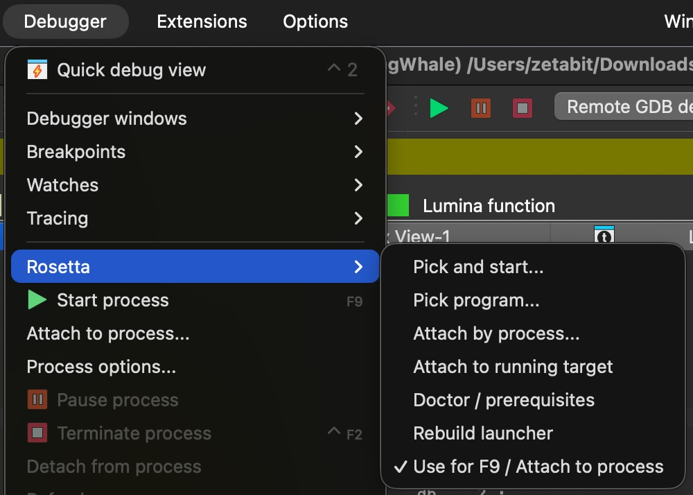
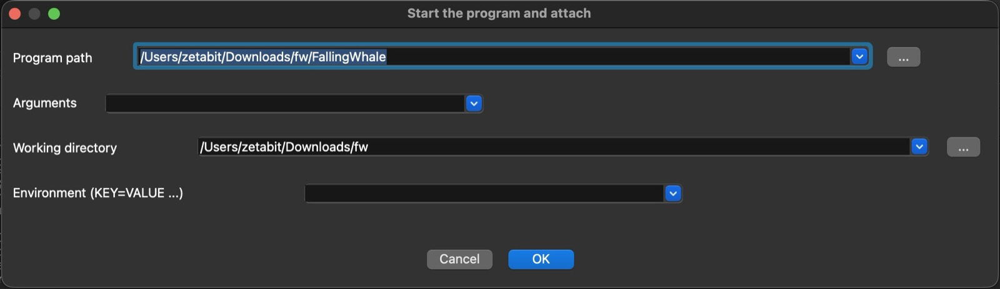
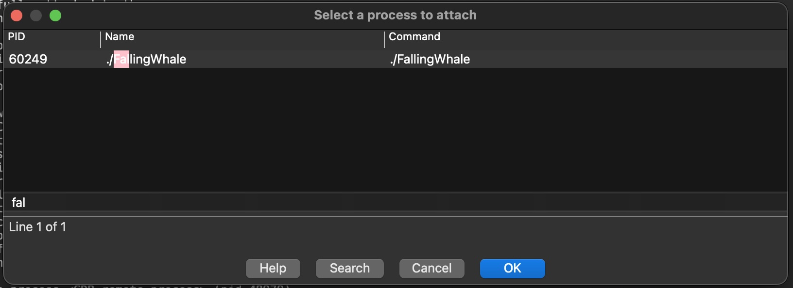
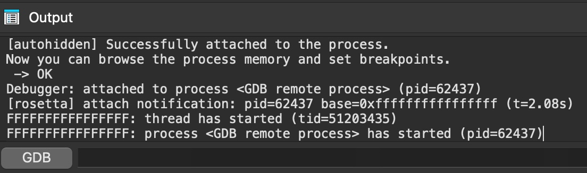

# ida-rosetta

[](https://github.com/zeetabit/ida-rosetta/actions/workflows/ci.yml)

**Debug x86_64 (Rosetta) processes with IDA Pro on Apple Silicon.**

IDA 9.x (arm64) cannot debug a translated x86_64 process: its macOS debugger is
ARM-only, and Apple's native `debugserver` refuses translated targets. Apple's
supported controller is `/usr/libexec/rosetta/debugserver`, a GDB RSP stub.
This plugin drives IDA's **Remote GDB** backend against that stub, so after the
attach everything (registers, memory, breakpoints, stepping, modules) is the
normal IDA debugger.

> **Status:** targets IDA 9.x arm64 on Apple Silicon with the Rosetta
> debugserver. It is not a debugger backend: it automates the Remote GDB
> attach — plus the config and launcher work — that IDA cannot do by itself.
> Breakpoints, stepping, registers and memory are IDA's own Remote GDB backend.
> See [CHANGELOG.md](CHANGELOG.md) for the current version.

## Why

| piece | reality |
|---|---|
| IDA's arm64 macOS debugger | arm64 targets only |
| Apple's native `debugserver` | refuses translated processes |
| Rosetta `debugserver` | GDB RSP stub; the supported controller |
| GDB `vFile` | not implemented by that stub → IDA can attach, not start |

Build-specific evidence is in [docs/DESIGN.md](docs/DESIGN.md).

LLDB applies the same policy internally for its own client: when it sees a
translated process it spawns/attaches through the Rosetta stub. That confirms
the mechanism, not that IDA has it. IDA's arm64 backend cannot debug translated
targets, and its Remote GDB mode does not know about the Rosetta stub. This
plugin supplies the missing client-side policy so the session stays inside IDA
(database, decompiler, cross-references, scripting, F9).

## How it works

```
IDA (arm64)                                   translated x86_64 process
┌──────────────────────────────┐              ┌────────────────────────┐
│ plugin/rosetta.py            │              │  program (x86_64)      │
│  F9 / Attach to process      │              │  __TEXT @ 0x100000000  │
│  → find pid, check base      │              └───────────▲────────────┘
│  → idle stub → attach        │                          │
│  → database breakpoints      │              ┌───────────┴────────────┐
│  → continue                  │  GDB RSP     │ rosetta/debugserver    │
└──────────────┬───────────────┘  127.0.0.1   │ (arm64e, idle, vAttach)│
               └──────────────────:1239──────►└────────────────────────┘
```

1. The target is started with **ASLR disabled** so it loads at the database's
   image base (`0x100000000` for a default PIE). The bundled `noaslr` launcher
   does this with `posix_spawn` + `POSIX_SPAWN_DISABLE_ASLR`.
2. The plugin finds the process, spawns an **idle** Rosetta stub, and calls
   `ida_dbg.attach_process(pid, -1)`.
3. IDA applies the database's breakpoints and continues.

## Screenshots

| | |
|---|---|
| `Debugger → Rosetta` submenu |  |
| Pick and start (path, arguments, cwd, environment) |  |
| Attach by process (filterable list) |  |
| Output log |  |

## Requirements

* IDA Pro 9.x, **arm64** build, on Apple Silicon
* macOS with Rosetta (the stub is present on 11+)
* `clang` from the Xcode command line tools — used **once** to build the
  launcher, and again whenever the plugin version or launcher source changes
* one-time IDA config override (below)

## Install

```bash
git clone https://github.com/zeetabit/ida-rosetta.git
cd ida-rosetta && make install      # install into the IDA user plugin dir
make status                         # show what is installed
# if a plugin is already installed:
#   make install FORCE=1            # back it up, then install
```

`make install` is idempotent: it reports *already installed* when the plugin
already comes from this checkout, refuses to clobber anything else, and keeps a
timestamped `.bak.*` when `FORCE=1` replaces a file. `make uninstall` removes
only the plugin this checkout installed.

Start IDA. The Output window should show:

```
[rosetta] v<version> installed: menu Debugger > Rosetta; F9 interception is OFF (port 1239)
[rosetta] note: dbg_gdb.cfg lacks the Rosetta register map; run ...
```

Then, in the IDA console, once:

```python
ida_kernwin.rosetta_install_cfg()   # writes $IDAUSR/cfg/dbg_gdb.cfg
```

and restart IDA. (This adds the `com.apple.debugserver.x86_64` register feature
to a *user-level override*; the app bundle is never modified and no `sudo` is
needed. Running the tool `tools/ida_gdb_cfg.py` does the same for a single
file.)

## Use

`Rosetta` is a real submenu, created at install time in two places — under
**Debugger** (primary) and next to the plugin entry in **Edit → Plugins** — with
the same actions. The `Edit → Plugins → "Rosetta debug"` entry itself runs
*pick and start…*.

| entry | what it does |
|---|---|
| **pick and start…** | dialog with program path, arguments, working directory and environment (`KEY=VALUE …`); starts it with the bundled launcher, then attaches |
| **pick program…** | only remembers the program for this database |
| **attach by process…** | filterable list of running processes (PID / name / command); attaches to the selected one |
| **attach to running target** | attaches to the already-selected program |
| **doctor / prerequisites** | version, launcher stamp, stub path, config-patch state, image bases |
| **rebuild launcher** | forces a rebuild from the embedded source |
| **use for F9 / Attach to process** | checkable toggle (remembered). **Off by default** — taking over IDA's own actions should be your decision, not the plugin's |

`Edit → Plugins → "Rosetta debug"` runs **pick and start…** as well.

Or start the target yourself and press **F9** after enabling the toggle once:

```bash
~/.idapro/plugins/ida-rosetta/noaslr /path/to/program
```

While **use for F9 / Attach to process** is off, the plugin does not touch those
actions at all — IDA handles them natively (and will fail for a translated
target); the menu entries keep working either way.

When the toggle is on, **F9 replays the last action you picked**:

* after *Pick and start…* → F9 starts the program (same args/cwd/env) and attaches;
* after *Attach to running target* or *Attach by process…* → F9 attaches to the
  running program (and tells you to start it if it is not).

That choice is stored as `ui.f9_action` (`start` / `attach`) in `settings.json`.

Console helpers:

```python
ida_kernwin.rosetta_start()         # the pick-and-start dialog
ida_kernwin.rosetta_attach_pid()    # process chooser
ida_kernwin.rosetta_attach()        # attach to the current target
ida_kernwin.rosetta_pick()          # choose another program
ida_kernwin.rosetta_doctor()        # compatibility / upgrade report
ida_kernwin.rosetta_rebuild()       # force launcher rebuild
ida_kernwin.rosetta_go()            # continue
```

## Upgrading (and rebuilding)

The launcher is **not** shipped as a binary. Its C source is embedded in the
plugin; on first use the plugin writes it to

```
~/.idapro/plugins/ida-rosetta/noaslr.c
```

and compiles a universal (arm64 + x86_64) `noaslr` next to it.

Every build is stamped in `launcher.json` with the **plugin version** and a
**SHA-256 of the embedded source**. On startup/use:

* version or source changed → rebuild automatically;
* the new binary is built to `noaslr.build` and swapped in atomically
  (`os.replace`), so a failed compile never breaks a working launcher;
* if the rebuild fails, the previous binary is kept and a warning is logged;
* force a rebuild at any time with `ida_kernwin.rosetta_rebuild()`, or by
  deleting `~/.idapro/plugins/ida-rosetta/`.

After an **IDA upgrade**:

1. IDA may replace `cfg/dbg_gdb.cfg`. Run `ida_kernwin.rosetta_doctor()`; if
   `roslyn map present` is `False`, run `ida_kernwin.rosetta_install_cfg()`
   again and restart IDA.
2. If the plugin's hook stops firing, check that the actions are still named
   `ProcessStart` / `ProcessAttach` (see `docs/COMPATIBILITY.md`).
3. `settings.json` is schema-versioned and migrates automatically.

## Files and state

`$IDAUSR` is IDA's user directory (`~/.idapro` by default).

```
$IDAUSR/plugins/rosetta.py                 installed plugin
$IDAUSR/plugins/ida-rosetta/noaslr         built launcher (universal)
$IDAUSR/plugins/ida-rosetta/noaslr.c       embedded source, written on build
$IDAUSR/plugins/ida-rosetta/launcher.json  version + source hash stamp
$IDAUSR/plugins/ida-rosetta/settings.json  per-idb target, args, break_off
$IDAUSR/plugins/ida-rosetta/stub.log       stub stderr
$IDAUSR/cfg/dbg_gdb.cfg                    patched copy (config override)
```

## Limitations

* **Attach only.** The stub has no `vFile`, so IDA's normal "Start process"
  cannot be used; the plugin intercepts `ProcessStart`/`ProcessAttach` and
  attaches instead. It does not appear in `Debugger → Switch debugger…`.
* The target must run at the database's image base (use the launcher).
* Depends on the IDA action names above and on `ida_dbg`'s API.
* One stub port (`1239`) per IDA instance.

## Documentation

* [docs/HEADLESS.md](docs/HEADLESS.md) — running under `idat -A -S…`
* [docs/USAGE.md](docs/USAGE.md) — every menu entry, both workflows, F9
  semantics, settings reference, console helpers
* [docs/DESIGN.md](docs/DESIGN.md) — why this is an attach helper, the measured
  stub behaviour, alternatives and the native debugger-module path
* [docs/COMPATIBILITY.md](docs/COMPATIBILITY.md) — version matrix and the
  post-upgrade checklist
* [docs/TROUBLESHOOTING.md](docs/TROUBLESHOOTING.md) — symptom → cause → fix
* [examples/generic_helper.py](examples/generic_helper.py) — target-independent template (symbolic breakpoints + `on_bpt`)
* [examples/fallingwhale_helper.py](examples/fallingwhale_helper.py) — FallingWhale policy using that template

## Troubleshooting

See [docs/TROUBLESHOOTING.md](docs/TROUBLESHOOTING.md). Start with
`ida_kernwin.rosetta_doctor()`, and if attach feels slow run

```bash
tests/rsp_probe.py --port 1239 --pid <pid>
```

## Design notes

[docs/DESIGN.md](docs/DESIGN.md) covers the evidence, the measured stub
behaviour, why this is an action hook instead of a native `debugger_t` module,
and what a native module would cost. [docs/COMPATIBILITY.md](docs/COMPATIBILITY.md)
has the version matrix and the post-upgrade checklist.

## License

MIT — see [LICENSE](LICENSE). Not affiliated with Hex-Rays or Apple.
